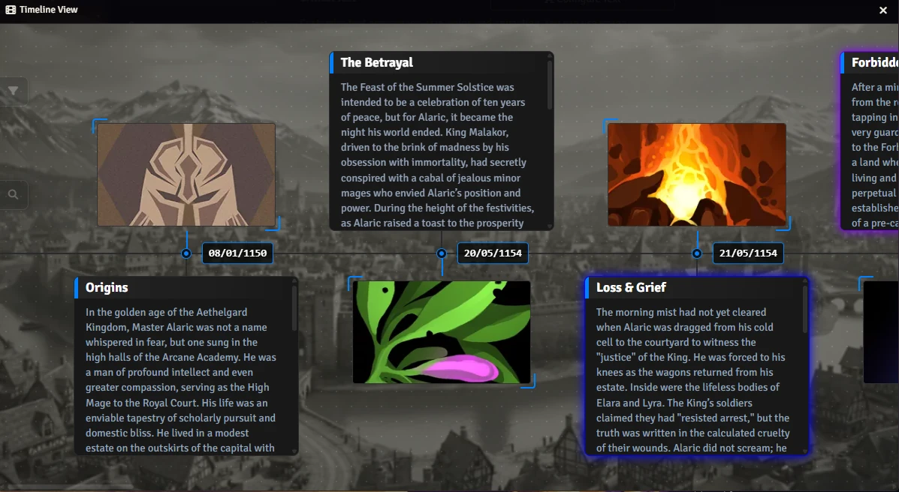
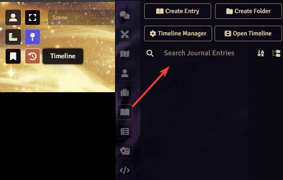

# Timeline Builder

Your players have heard about the Fall of the Old Empire three times, and each time it happened in a different year. Timeline Builder puts your world's history on one horizontal line inside Foundry: each event has a date, a description, an image and, if you want, a link to a journal page. Players scroll through it, filter by tag, and see only what you decided to show. It works for campaign arcs, world lore and character backstories.

<p align="center"></p>

[](https://buymeacoffee.com/mestredigital) [](https://mestredigital.online/pages/projetos-en)

## What it does

- Events are laid out in a zig-zag along a horizontal line. You drag the view to scroll, and clicking an image opens it full size, so maps and artwork can be inspected.
- An event can be marked with an animated effect: Glow (Light), Glow (Strong), Float, Shake, Pulse or Glitch. The line itself can have its own effect: Flow, Pulse, Glitch, **Neon Flicker** or **Chroma / Spectrum**.
- Each timeline has its own look. The line can be Solid, Dashed or **Rough / Ink**, the dots can be rings, circles or squares in four sizes, and the colors are yours to choose.
- **Mystery Mode** shows players that an event happened while hiding its image, its text (name, description and tags) or its timeframe until you reveal it.
- An event can be linked to one of your **Journal Entries**. Players click the page icon on the event to open the full lore page.
- **Tags** sort events into groups such as "War", "Politics" or "Personal", and players can filter the view to show only the tags they care about.
- A period marks a war, a reign or an age as a span of events instead of a single point. You pick the event where it starts and the event where it ends, and the period follows those events when you reorder them. The viewer draws it as a colored bar above the line, the PDF export marks it in the margin, and each timeline can switch periods off.
- You decide what players see. A whole timeline can be hidden, shown to everyone or only to some players, and single events can be hidden inside a visible timeline. **Broadcast** opens a timeline on the screen of every connected player at once.
- The **PDF** button in the Manager downloads the timeline as a paginated file with every event's timeframe, title, description, tags and images.
- To back up timelines or move them to another world, open **Configure Settings**, then **Import / Export**, and export any selection of timelines as a JSON file. When you import them elsewhere, id conflicts are detected and you choose to skip, replace or import as a copy.

## How to use it

1.  Go to the Notes layer (left toolbar) and click the **Timeline** (clock) icon. As GM, you can read the full instructions in **Configure Settings**, on the **Timeline Builder** tab, with the **Instructions** button.

<p align="center"></p>

You can also use macros:

```js
Timeline.Open();
```

```js
Timeline.Manage();
```

2.  As GM, use the Manager to build timelines, add events, and drag and drop them to change their order.

<p align="center"></p>

3.  Pick the colors, line style and effects for each timeline and event. To group events into periods, click **Periods** in the Manager's toolbar. The **Timeline Periods** window lists them, and its **Off** and **Lane** options choose whether they are drawn. Up to three periods can overlap on the same events. A fourth is not drawn, and the window marks it as not shown. A period that starts or ends on an event hidden from players is not shown to them.
4.  Players open the viewer to read the history you wrote.

## Installation

Install it from the Foundry VTT module browser, or use this manifest link. It requires Foundry VTT v14.

```js
https://github.com/brunocalado/timeline-builder/releases/latest/download/module.json
```

## ⚖️ Credits and License

* **Code License:** GNU GPLv3.
